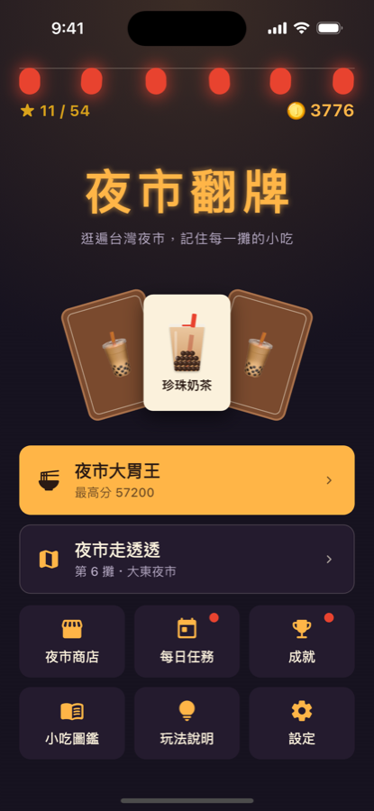
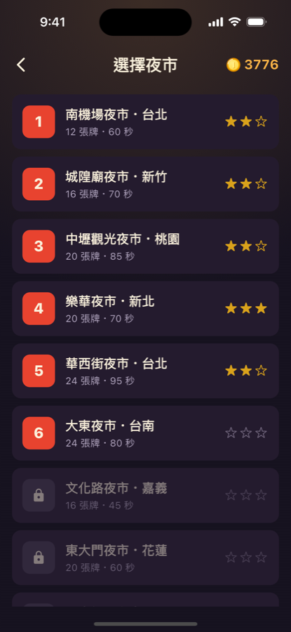
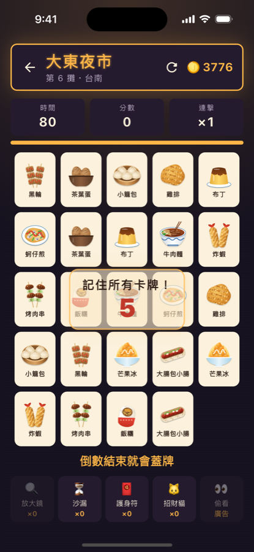
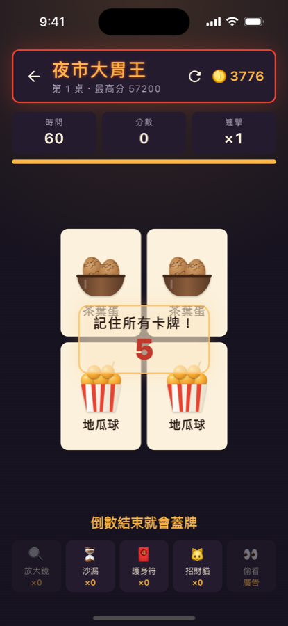
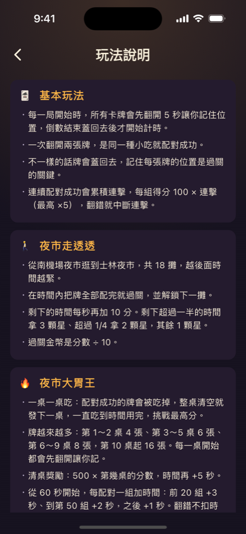

# 夜市翻牌 Night Market Match

逛遍台灣夜市的翻牌記憶遊戲。從南機場夜市一路逛到士林夜市，翻開兩張一樣的小吃就能配對，記住每一攤的好味道。

以 Flutter 開發，支援 iOS 與 Android。

<p align="center">
  
  
  
  
  
</p>

## 遊戲特色

### 兩種玩法
- **夜市走透透（闖關）**：18 攤台灣知名夜市，越後面時間越緊。在時限內配完所有牌即可過關，依剩餘時間拿 1～3 顆星，並解鎖下一攤。
- **夜市大胃王（無盡挑戰）**：一桌一桌清，牌桌從 2×2 逐漸變成 4×4。清桌可拿「500 × 第幾桌」的獎勵分數與加時，一直吃到時間用完，挑戰最高分。

### 遊戲機制
- **開局翻牌記憶**：每一局（大胃王則是每一桌）開始時所有卡牌先翻開，倒數結束才蓋牌開始計時。
- **連擊計分**：連續配對成功累積連擊，每組得分為 100 × 連擊。
- **老闆提示**：大胃王中連續翻錯 2 次，老闆會偷偷亮出一組對子（有冷卻，避免被濫用）。
- **道具與裝備**：放大鏡、沙漏、護身符、招財貓 4 種道具；帽子（加時）、算盤（加金幣）、攤車（提高連擊上限）、老花眼鏡（延長記牌時間）、保溫便當袋（翻錯少扣連擊）等 7 種可升級裝備，其中 2 種為大胃王限定。時間到時會依這局的表現建議該升級哪件裝備。
- **收集要素**：20 種小吃圖鑑、14 款卡背（含成就限定，各有不同花紋）、16 個成就、每日任務與 7 日連續簽到。
- **廣告獎勵**：看廣告可偷看全部卡牌、時間到續命 15 秒、過關金幣 ×2（Google AdMob）。

### 畫面演出
- 夜市開張的開場動畫：遮雨棚降下、燈籠依序點亮、小吃彈出，與資源載入同步進行。
- 配對特效依連擊強度放大；大胃王配對時兩張牌浮起相撞後消失，清桌時施放煙火。
- 支援系統「減少動態效果」設定，開啟時略過大型動畫。

## 技術重點

| 項目 | 內容 |
|---|---|
| 框架 | Flutter 3.27（Dart 3.6），以 FVM 管理版本 |
| 平台 | iOS、Android（targetSdk 36 / Android 16，原生函式庫符合 16 KB 分頁） |
| 套件 | `shared_preferences`（存檔）、`google_mobile_ads`（AdMob）、`audioplayers`（音效與背景音樂） |
| 測試 | 118 個單元測試與 Widget 測試 |

### 架構設計
- **遊戲邏輯與畫面分離**：`lib/game/` 是不依賴 Flutter UI 的純 Dart 邏輯（`MatchingGame`、`EndlessGame`），計分、計時、發牌、道具效果都能直接單元測試。
- **依賴介面而非實作**：畫面只依賴 `AdService`、`SoundService` 介面，測試時注入假的實作，不需要真的播廣告或音效；亂數產生器也可注入，讓洗牌結果可重現。
- **存檔集中管理**：`ProgressStore` 統一處理金幣、星數、道具、成就、每日任務等存檔，key 名稱固定，避免上架後玩家存檔讀不到。

### 素材全部自行產生
沒有使用外部圖庫或音樂素材，避免版權問題：
- 20 種小吃插圖與 App 圖示：以 Swift（AppKit）程式繪製（`tools/make_food_icons.swift`、`tools/make_icon.swift`）。
- 音效與背景音樂：以 Python 合成（`tools/make_sounds.py`、`tools/make_music.py`），背景音樂是烏克麗麗風格、可無縫循環；記牌倒數與最後 5 秒也有提示音效。
- 金幣圖示、遮雨棚、煙火粒子、卡背花紋（含麻將牌面）等：以 Flutter `CustomPainter` 即時繪製。
- 使用的開源套件授權可在 App 的「設定 → 開源授權」查看。

### 測試涵蓋
- 遊戲規則：計分、連擊、時間加減、清桌獎勵、道具效果、老闆提示的冷卻。
- 畫面流程：開場動畫、開局翻牌倒數、過關與時間到的結算、看廣告續命、廣告播放失敗的處理。
- 版面：在最小的螢幕（iPhone SE，寬 320pt）上檢查各畫面不跑版。
- 動畫時序：逐格檢查配對相撞動畫、確認特效會按時播完不會重播。

## 專案結構

```
lib/
├── main.dart                 App 進入點
├── theme.dart                夜市配色
├── game/                     純遊戲邏輯（不依賴 UI）
│   ├── matching_game.dart    夜市走透透
│   ├── endless_game.dart     夜市大胃王
│   ├── night_market_data.dart  夜市與小吃資料
│   ├── items.dart            道具與裝備
│   ├── achievements.dart     成就與每日任務
│   └── card_skins.dart       卡背
├── screens/                  各畫面
├── services/                 存檔、廣告、音效
└── widgets/                  共用元件（卡片、特效、金幣圖示等）
test/                         單元測試與 Widget 測試
tools/                        產生圖案、圖示、音效、音樂的腳本
assets/                       小吃圖片、App 圖示、音效
```

## 執行方式

```bash
# 安裝套件（專案以 FVM 固定 Flutter 版本）
fvm flutter pub get

# 在模擬器或手機上執行
fvm flutter run

# 執行測試
fvm flutter test
```

重新產生素材：

```bash
python3 tools/make_sounds.py assets/sounds
python3 tools/make_music.py assets/sounds
swift tools/make_food_icons.swift assets/foods && sips -Z 256 assets/foods/*.png
swift tools/make_icon.swift assets/icon && fvm dart run flutter_launcher_icons
```

### Android 正式簽章

上架用的 `.aab` 以上傳金鑰簽署。金鑰檔與密碼不在 repo 裡，設定放在 `android/key.properties`（已被 `.gitignore` 排除）：

```properties
storePassword=<密碼>
keyPassword=<密碼>
keyAlias=upload
storeFile=<金鑰檔的完整路徑>
```

```bash
fvm flutter build appbundle --release   # 輸出 build/app/outputs/bundle/release/app-release.aab
```

沒有 `key.properties` 時，release 版會改用 debug 金鑰，只能自己測試，無法上傳 Google Play。

## 開發狀態

遊戲功能已完成，正在準備上架 Google Play 與 App Store。目前廣告使用 Google 官方的測試 ID。
